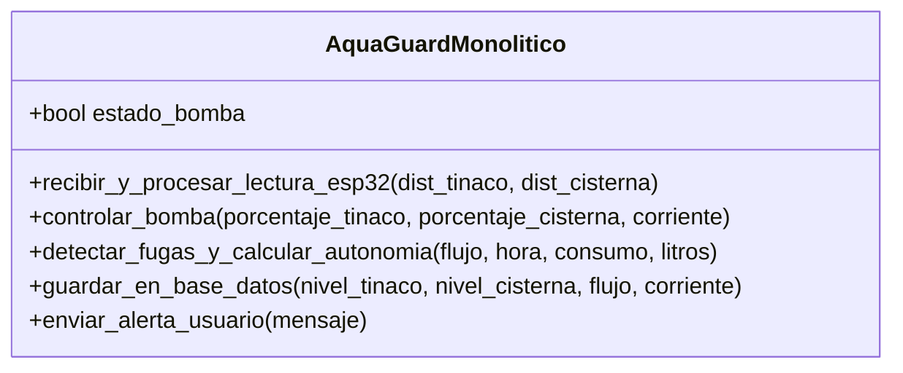
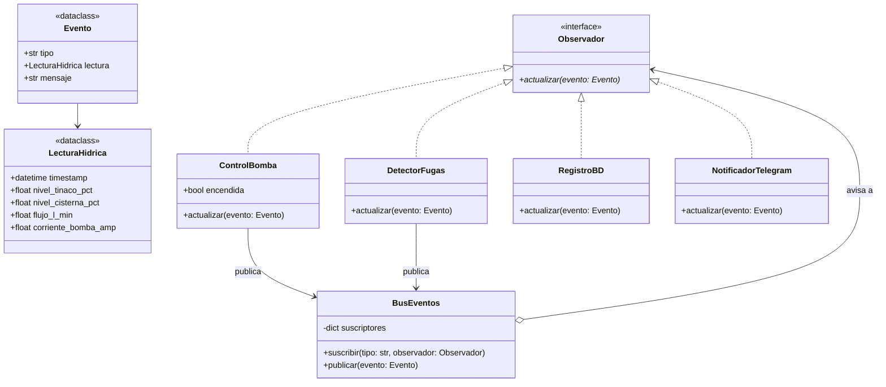

# Propuesta de Mejora — José Adrián Caleano Luna

Arquitectura basada en eventos con el patrón **Observer**.

## 1. Diagrama Diseño Original (Monolítico)


## 2. Diagrama Diseño Mejorado (Propuesta Adrián)


## 3. Cómo funciona
1. El ESP32 manda una lectura y se publica el evento `lectura_nueva` en el `BusEventos`.
2. `ControlBomba` y `DetectorFugas` están suscritos a `lectura_nueva`. Cada uno revisa la lectura por su lado.
3. Si pasa algo, publican su propio evento: `bomba_encendida`, `bomba_apagada`, `paro_emergencia` o `fuga_detectada`.
4. `RegistroBD` guarda todos esos eventos y `NotificadorTelegram` solo avisa al residente de los importantes (paro de emergencia y fuga).

Para probarlo: `cd propuesta_adrian && python3 main.py`

```
[BD] 14:00 bomba_encendida Llenado automático.
[BD] 15:00 bomba_apagada Tinaco lleno.
[BD] 03:00 fuga_detectada Posible fuga nocturna (0.4 L/min).
[Telegram] Posible fuga nocturna (0.4 L/min).
[BD] 16:00 paro_emergencia Cisterna baja (<10%). Paro anti-seco.
[Telegram] Cisterna baja (<10%). Paro anti-seco.
```

## 4. Justificación Técnica
* **Bajo acoplamiento:** los módulos no se conocen entre sí, solo conocen el bus. `ControlBomba` no sabe que existe la base de datos ni Telegram.
* **Extensibilidad:** para agregar alertas por correo o un dashboard se crea un nuevo `Observador` y se suscribe en `main.py`, sin tocar las clases que ya existen (principio abierto/cerrado).
* **Pruebas (Testing):** cada observador se prueba solo, mandándole un `Evento` armado a mano.
* **Encaja con IoT:** el ESP32 ya trabaja mandando lecturas cada cierto tiempo, así que pensar el sistema como eventos que llegan y se reparten es natural.
* **Diferencia con la Fachada:** en la propuesta de Roberto la fachada decide el orden y llama a cada servicio. Aquí nadie coordina; cada módulo reacciona a lo que le interesa.
