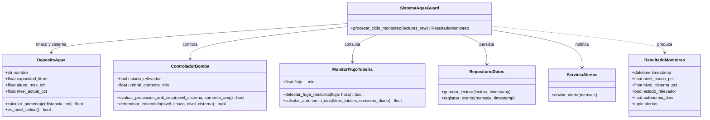

# Propuesta de Óscar: componentes físicos del dominio IoT

## Diseño orientado al hardware

La propuesta organiza el sistema según los elementos físicos que interactúan
con la vivienda. `DepositoAgua` representa un tinaco o una cisterna y traduce
la distancia medida por un sensor ultrasónico JSN-SR04T a un porcentaje de
llenado, aplicando los límites propios de la geometría del depósito.

`ControladorBomba` representa el conjunto de bomba y relevador de 30 A. Mantiene
el estado del relevador, aplica la protección anti-seco con el nivel de
cisterna y la corriente observada por el SCT-013, y controla el llenado del
tinaco con umbrales de arranque y paro. `MonitorFlujoTuberia` representa el
medidor YF-S201: conserva el flujo actual, detecta circulación nocturna
inusual y estima la autonomía a partir de los litros disponibles y el consumo
diario.

Las reglas operativas iniciales usan valores ajustables: 10% como nivel crítico
de cisterna, 15% como reserva mínima para arrancar la bomba, 25% para iniciar
el llenado del tinaco, 95% para detenerlo, 0.5 A como corriente mínima y
0.15 L/min como umbral de flujo nocturno. El periodo de detección de fuga es
desde las 02:00 hasta antes de las 05:00. Estos valores son referencias de
diseño y deben calibrarse con las dimensiones, sensores y consumo reales.

`SistemaAquaGuard` es el orquestador: toma un mapeo de lecturas crudas, calcula
los niveles a partir de distancias, aplica las decisiones de seguridad y
control, calcula autonomía y coordina el registro y las alertas. Para una
integración inicial, `RepositorioDatos` y `ServicioAlertas` simulan, en memoria,
la persistencia con timestamp y las notificaciones; no realizan conexiones
externas.

## Escalabilidad física

El modelo de depósito no depende de que el equipo sea específicamente un
tinaco o una cisterna: cada instancia tiene nombre, capacidad, altura y umbral
crítico propios. Por ello, agregar un segundo tinaco requiere crear otra
instancia con sus dimensiones y asociarla a una estrategia de control, en vez
de modificar las reglas internas de un único objeto que conozca todos los
depósitos.

De forma análoga, una segunda bomba puede representarse con otra instancia de
`ControladorBomba`, con su estado y umbral de corriente independientes. Esto
permite incorporar controladores por zona y sensores adicionales de flujo o
corriente, conservando el contrato de cada componente físico. Para operar
múltiples bombas en producción, el orquestador podría ampliarse para recibir
colecciones o una política de asignación sin convertir las clases de depósito
en controladores de actuadores.

## Diagrama de clases

## Beneficios de software

- **Mantenibilidad y responsabilidad única:** cada clase concentra reglas de un
  dispositivo o servicio. Un cambio en el cálculo del sensor ultrasónico no
  obliga a modificar el almacenamiento o las notificaciones.
- **Pruebas aisladas:** los componentes se instancian por separado y los
  servicios actuales almacenan sus resultados en memoria. Se pueden comprobar
  límites, apagado por seguridad y detección nocturna sin hardware conectado.
- **Principio abierto/cerrado (OCP):** los adaptadores de persistencia y
  notificación pueden sustituirse por implementaciones de base de datos,
  Telegram o correo sin reescribir las reglas de dominio. También se pueden
  extender las clases mediante nuevos componentes para hardware adicional.
- **Reutilización:** `DepositoAgua` sirve para distintos depósitos y
  `MonitorFlujoTuberia` puede reutilizarse en cada tramo instrumentado. Los
  servicios de soporte son independientes del tipo de bomba o depósito.
- **Contratos explícitos:** type hints, validaciones y `ResultadoMonitoreo`
  hacen visibles las unidades, los datos requeridos y el resultado de cada
  ciclo, reduciendo errores al integrar lecturas del ESP32.
