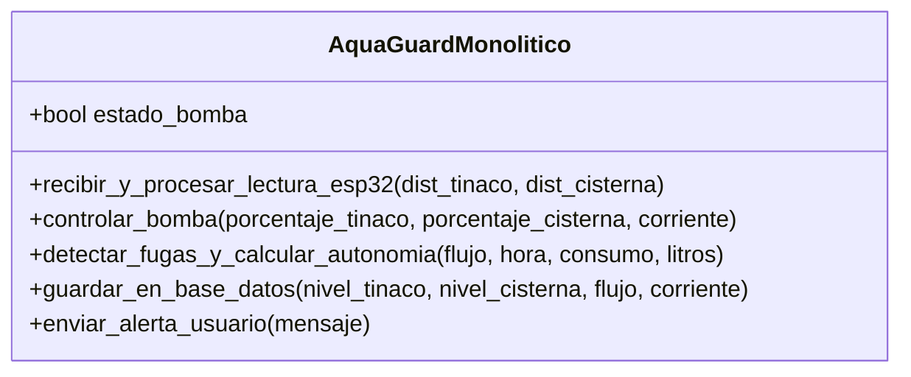
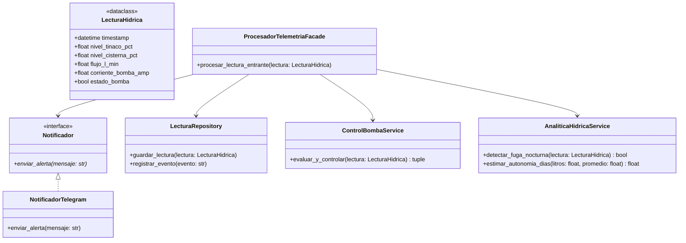

# Propuesta de Mejora — Roberto Carlo Lisjuán Pérez

## 1. Diagrama Diseño Original (Monolítico)

## 2. Diagrama Diseño Mejorado (Propuesta Roberto)

## 3. Justificación Técnica
* **Mantenimiento:** Separar `AnaliticaHidricaService` de `ControlBombaService` permite ajustar modelos de IA sin arriesgar las reglas eléctricas de protección anti-seco.
* **Pruebas (Testing):** La inyección de dependencias en `ProcesadorTelemetriaFacade` permite simular la base de datos y alertas mediante *Mocks*.
* **Reutilización y Escalabilidad:** La interfaz `Notificador` permite añadir alertas por correo o WhatsApp sin modificar las clases existentes.